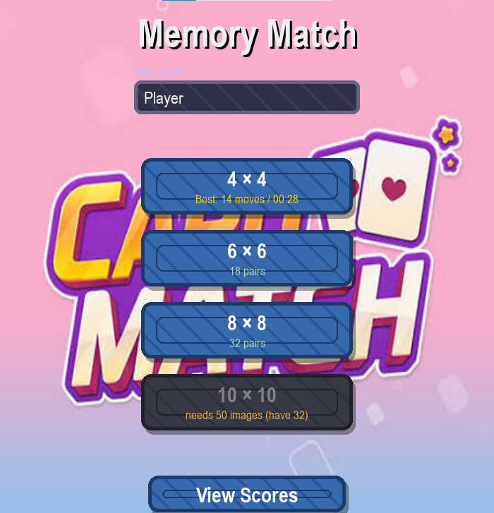
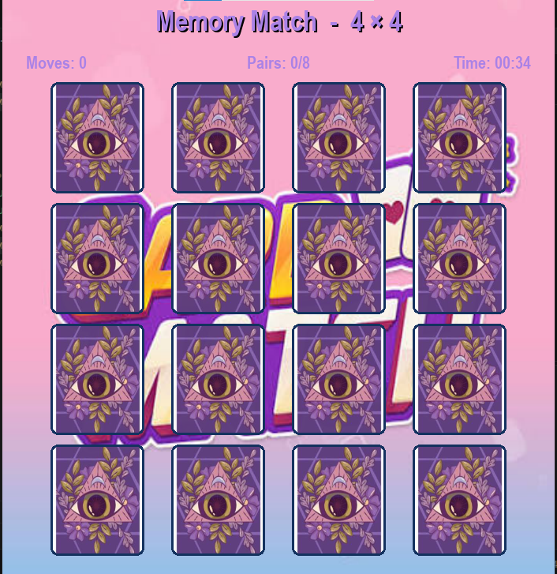
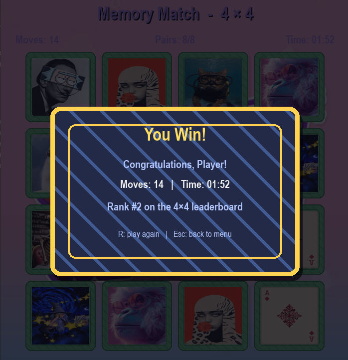
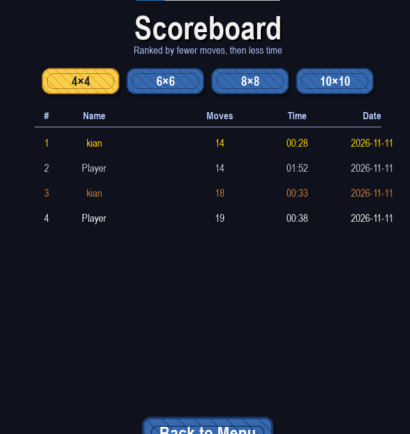

# 🎴 Memory Match (Pygame)

A classic **Memory Match** (also known as **Concentration**, **Memory**, or **Pelmanism**) card game built with **Pygame**. Flip cards two at a time and try to find all matching pairs with as few moves as possible.

Before the game starts, you choose your board size (**4×4**, **6×6**, **8×8**, or **10×10**). The game automatically scans the `images/` folder, loads every valid image it finds, and uses as many as needed for the selected board size.

The game includes a **persistent scoreboard per board size**, a customizable **player name**, and **polished visuals** — gradient or custom backgrounds, decorative card-style buttons, and a custom card back.

---

## 📖 About the Game

The game of memory Match is old and famouse game for all age groups.the game have different name around the world such as Concentration in the United States, Pelmanism in the UK, Memory in Germany, and Pairs in many other countries.  the game have a simple idea: finding matching pairs of cards. It's easy to learn for players, fun to play, and also a good game for train your memory, concentration, visual recognition, and the ability to remember where things are placed.

The gameplay is very simple. All cards are placed face-down on a table or board, with each card having one matching pair hidden somewhere. Players take turns flipping over two cards at a time. If the cards match with together, they stay face-up and the player get a point. If they don't match, both cards are turned face-down again. The challenge for this game is remembering the positions of previously revealed cards so you can find their matching pairs later.

 The best things about Memory Match is that every game feels different. The cards are shuffled randomly at the beginning of each round, so players never know where the matching pairs will be.the players can play harder if they want for example a small 4×4 board is a good starting point for beginners and younger players, while a larger 10×10 board with 50 pairs offers a much greater challenge and requires strong memory.

---

## 🎯 Game Rules in Detail

### The board

- The board is a **square grid** of cards, all initially face-down with a picture on the back.
- Each grid size determines the total number of cards and pairs:

  | Board size | Total cards | Pairs |
  |------------|-------------|-------|
  | **4×4**    | 16          | 8     |
  | **6×6**    | 36          | 18    |
  | **8×8**    | 64          | 32    |
  | **10×10**  | 100         | 50    |

- Every image in the deck appears **exactly twice** — once as a pair. There are no unpaired cards.

### A turn

1. **Click any face-down card.** It flips face-up and reveals its image. This is your **first pick**.
2. **Click a second face-down card.** It also flips. This is your **second pick**.
3. The game compares the two images:
   - ✅ **If they match** → both cards turn **green** and remain face-up permanently. Your pair counter increases by one.
   - ❌ **If they don't match** → both cards flip back **face-down after a short delay** (800 ms by default). Your move counter still increases — every attempt counts.
4. Play continues until **every pair on the board has been matched**.

### Winning

- There is **no "losing"** in this game — the only outcome is *how few moves* and *how little time* you needed.
- When the last pair is found, the timer stops and a **"You Win!"** overlay appears with your final **move count**, **elapsed time**, and **your rank** on that size's leaderboard.

### What counts as a "move"

A **move** is one complete flip pair (one first-pick + one second-pick). So:
- Two cards that match = **one move**.
- Two cards that don't match = still **one move**.
- The theoretical perfect game on a 4×4 board is **8 moves**. Realistically, most players need 12–20.

---

## 🧠 Strategy & Tips

Memory Match looks like pure luck, but skilled players consistently clear boards in far fewer moves. Techniques that matter:

### 1. Start from the corners and edges
Flip cards in a **systematic order** (top-left → top-right → bottom-left → bottom-right) rather than randomly. This builds a mental map.

### 2. Chunk the board into regions
Mentally divide the board into **quadrants** and focus on one at a time. Human short-term memory holds roughly 7 ± 2 items — chunking lets you store more by grouping.

### 3. Use verbal or visual anchors
Give each image a quick mental label ("red flower", "blue cat", "sun"). Attaching a **word** to a **position** makes it far more memorable than raw pixels.

### 4. Re-flip known matches first
If you know where a pair is, flip the known pair first to score, then use your remaining flips to explore.

### 5. Track mismatches on purpose
When a mismatch happens, **deliberately note both positions** before they flip back. Those two locations are now "known" — you just need their partners.

### 6. Exploit the mismatch delay
The 800 ms delay before a wrong pair flips back is **free study time**. Watch carefully.

### 7. On large boards, work methodically
On 8×8 and 10×10, resist random clicking. Pick a scan order and stick to it.

---

## ✨ Features

### Gameplay
- ✅ **Board size selection menu** (4×4, 6×6, 8×8, 10×10)
- ✅ **Player name input** on the menu — used in the scoreboard and win screen
- ✅ Move counter and live timer
- ✅ Win overlay with final stats and your rank
- ✅ Hover highlight on clickable cards
- ✅ Unplayable board sizes are **automatically greyed out** with a hint showing how many more images are needed
- ✅ Quick restart with `R`
- ✅ Return to menu with `Esc` (rescans images on return)
- ✅ Graceful error message if the `images/` folder is missing or empty

### Scoreboard 🏆
- ✅ **Persistent scoreboard per board size** — separate tables for 4×4, 6×6, 8×8, and 10×10
- ✅ **Top 10 scores per size**, saved to `scores.json`
- ✅ Ranked by **fewest moves**, ties broken by **fastest time**
- ✅ **Best record preview** shown on each size button in the menu
- ✅ Gold / silver / bronze coloring for the top 3 ranks
- ✅ **"New Record!" indicator** in the win screen when you finish rank #1
- ✅ **Tabbed score screen** with quick-switch keys `1`–`4`
- ✅ Safe loading — a corrupted or missing `scores.json` is silently recreated

### Visuals 🎨
- ✅ **Custom background image** support (`background.png` / `.jpg` / `.jpeg` / `bg.*`)
- ✅ **Custom card back image** support (`card_back.*`) with **zoom control**
- ✅ **Procedural fallback** — if no images are provided, a gradient + bokeh background and a patterned card back with a `?` are generated automatically
- ✅ **Decorative card-style buttons** with diagonal patterns, rounded corners, inner frames, and drop shadows
- ✅ **Card-style tabs** on the scoreboard, **card-style panel** on the win overlay
- ✅ **Gold-themed win panel** when you set a new record
- ✅ **Purple HUD text** (`HUD_PURPLE`) for title, moves, pairs, and timer
- ✅ **Cached surfaces** — backgrounds, card backs, and button styles are built once and reused for smooth performance even on 10×10

### Images
- ✅ **Auto-scan** of the `images/` folder — any filenames are accepted
- ✅ Supports `.png`, `.jpg`, and `.jpeg`
- ✅ Automatic smooth scaling of images to fit each card size
- ✅ Cards, fonts, and back icons resize automatically per board size

---

## 📋 Requirements

- **Python 3.8+**
- **Pygame**

Install Pygame:

```bash
pip install pygame
```

---

## 📁 Project Structure

Your project folder should look like this:

```
project/
├── main.py
├── scores.json          ← created automatically
├── background.jpg       ← optional (background image)
├── card_back.png        ← optional (card back image)
└── images/
    ├── 1.jpg            (or 1.png / 1.jpeg)
    ├── 2.jpg
    ├── 3.jpg
    ├── 4.jpg
    ├── 5.jpg
    ├── 6.jpg
    ├── 7.jpg
    └── 8.jpg            ← plus any additional images you want
```

### Rules for image files

- **Any filename is accepted** — the game auto-scans the folder.
- **Extensions can be** `.png`, `.jpg`, or `.jpeg`.
- **Recommended minimum size:** 120×120 pixels (square preferred).
- **PNG with transparent background** looks best, but JPG works fine.
- Each image will be **automatically scaled** to fit the current card size.
- **Avoid duplicate images** — if the same picture appears under two different filenames, the game treats them as two separate pairs.

### Reserved filenames (NOT used as game cards)

The following base names are skipped by `scan_images()` so they can be used for UI art instead:

| Base name | Purpose |
|-----------|---------|
| `background`, `bg`, `menu_bg` | Custom background image (searched in root, then in `images/`) |
| `card_back` | Custom card back image (searched in root, then in `images/`) |

> 💡 You can place these in the project root **or** in the `images/` folder — the game checks both.

### How many images do I need?

| Board size | Total cards | Pairs needed |
|------------|-------------|--------------|
| **4×4**    | 16          | 8            |
| **6×6**    | 36          | 18           |
| **8×8**    | 64          | 32           |
| **10×10**  | 100         | 50           |

> ⚠️ A board size only becomes **playable** if the `images/` folder contains at least that many valid images. Otherwise, its button is greyed out with a message like _"needs 18 images (have 8)"_.

---

## 🚀 How to Run

1. Make sure the `images/` folder sits **next to** `main.py`.
2. Open a terminal in the project folder:

```bash
cd path/to/your/project
python main.py
```

Alternatively, on Windows you can double-click `main.py`.

---

## 🕹️ How to Play

### 1. Menu Screen

When the game starts, you'll see:

- A **name input field** at the top — type your name (used in the scoreboard and win screen).
- **Four size buttons** — 4×4, 6×6, 8×8, 10×10. Each shows:
  - The size label
  - The **best record** for that size (if any), in gold
  - Or the pair count if there's no record yet
- A **View Scores** button to open the scoreboard.
- The footer showing how many images are loaded.

A size button is **enabled (blue)** only if you have enough images. Disabled buttons appear **greyed out** with a hint like _"needs 18 images (have 8)"_.

### 2. Game Screen

1. All cards start **face-down** with a decorative back.
2. Click any card — it flips and reveals its image.
3. Click a **second** card:
   - ✅ **Match** → both turn **green** and stay face-up.
   - ❌ **No match** → both flip back after **800 ms**.
4. Keep going until all pairs are matched.
5. When you win, a **panel** appears with your stats and your rank on that size's leaderboard. If you placed **#1**, the panel turns **gold** and shows _"★ New Record! ★"_.

### 3. After the Game

- Press `R` to **restart with the same board size** (new shuffle, new random images).
- Press `Esc` to **return to the menu** and pick a different size.

### 4. Scoreboard

Open it from the menu with **View Scores**, or press keys `1`/`2`/`3`/`4` to jump to a specific size's tab. Each tab shows the **top 10** results for that size, ranked by:

1. **Fewest moves** (primary)
2. **Fastest time** (tiebreaker)

Each row shows: rank, player name, moves, time, and date. The top 3 are colored **gold**, **silver**, and **bronze**.

---

## 🏆 Scoreboard Details

### Storage

Scores are saved in **`scores.json`** next to `main.py`. The file is created automatically when the first score is added.

Format:

```json
{
  "4": [
    {"name": "Ali", "moves": 12, "time": 45230, "date": "2025-11-11 14:30"},
    {"name": "Sara", "moves": 15, "time": 51000, "date": "2025-11-11 15:02"}
  ],
  "6": [ ... ],
  "8": [ ... ],
  "10": [ ... ]
}
```

- `time` is in **milliseconds**.
- Each size keeps at most **10 entries** (`MAX_SCORES_PER_SIZE`).
- Invalid entries are filtered out on load, so a partially corrupted file won't crash the game.

### Resetting the scoreboard

Just **delete `scores.json`** — it will be recreated empty on the next launch.

### Configuring

```python
MAX_SCORES_PER_SIZE = 10      # how many scores to keep per size
SCORES_FILE = "scores.json"   # filename
```

---

## ⌨️ Controls

### On the Menu Screen

| Action          | Function                              |
|-----------------|---------------------------------------|
| **Left click** on name field | Focus the name input         |
| **Left click** on a size     | Start a game with that size  |
| **Left click** on View Scores| Open the scoreboard          |
| **`Enter`** (while editing name) | Unfocus the name field   |
| **`Backspace`** (while editing name) | Delete last character |
| **`Esc`**       | Quit the game                         |

### On the Scoreboard Screen

| Action          | Function                              |
|-----------------|---------------------------------------|
| **Left click** a tab | Switch to that size's leaderboard |
| **`1`** / **`2`** / **`3`** / **`4`** | Jump to that size's tab  |
| **Left click** Back to Menu | Return to menu            |
| **`Esc`**       | Return to menu                        |

### On the Game Screen

| Action          | Function                              |
|-----------------|---------------------------------------|
| **Left click**  | Flip a card                           |
| **`R`**         | Restart with the same board size      |
| **`Esc`**       | Return to the menu (rescans images)   |

---

## 🎨 Customization

### Top-of-file settings

```python
# Window dimensions
WIDTH, HEIGHT  = 700, 800

# Game rules
MISMATCH_DELAY = 800              # Delay before wrong cards flip back (ms)

# Available board sizes
GRID_OPTIONS   = [4, 6, 8, 10]

# Folders / files
IMAGES_DIR     = "images"
SCORES_FILE    = "scores.json"
MAX_SCORES_PER_SIZE = 10
```

### Colors

All colors are defined at the top of `main.py`:

```python
BG_TOP               = (18, 20, 40)     # Procedural background gradient (top)
BG_BOTTOM            = (42, 48, 80)     # Procedural background gradient (bottom)

CARD_BACK_BASE       = (55, 105, 175)   # Card back base color
CARD_BACK_PATTERN    = (38, 78, 138)    # Card back diagonal pattern
CARD_BACK_BORDER     = (20, 50, 95)     # Card back border

BTN_BASE             = (55, 105, 175)   # Menu button base
BTN_HOVER_BASE       = (250, 205, 75)   # Menu button hover (gold)
BTN_DISABLED_BASE    = (55, 58, 70)     # Disabled button

CARD_FACE            = (245, 245, 250)  # Revealed card
CARD_MATCHED         = (105, 195, 125)  # Matched card (green)

TEXT_COLOR           = (240, 240, 240)  # Default white text
HUD_PURPLE           = (170, 130, 230)  # HUD text (title, moves, pairs, time)
HINT_COLOR           = (180, 200, 255)  # Hints and footers
WIN_COLOR            = (255, 220, 100)  # "You Win!" text

GOLD_COLOR           = (255, 215, 0)    # Rank #1
SILVER_COLOR         = (200, 200, 210)  # Rank #2
BRONZE_COLOR         = (205, 127, 50)   # Rank #3
```

### Custom background

Place any of these files in the project root or in `images/`:

```
background.png   |   background.jpg   |   background.jpeg
bg.png           |   bg.jpg           |   bg.jpeg
menu_bg.png      |   menu_bg.jpg      |   menu_bg.jpeg
```

The game will scale it to the window size. If none is found, a **gradient + soft bokeh** background is generated automatically.

### Custom card back (with zoom)

Place a `card_back.png` / `.jpg` / `.jpeg` in the project root or in `images/`. Then, inside `build_card_back()`, adjust:

```python
ZOOM = 1.30   # 1.0 = exact card size, 1.3 = 30% larger (edges cropped)
```

- `1.0` — exact card size, no zoom
- `1.15` — slightly larger
- `1.30` — recommended (30% larger, edges cropped)
- `1.50` — larger, more of the edges cropped
- `2.0` — very large (only the center is visible)

If no `card_back` image is found, a **patterned card back with a `?`** is generated procedurally.

### Adjusting difficulty

The difficulty knob is `MISMATCH_DELAY`:

- **400 ms** → very hard, almost impossible to study the cards
- **800 ms** → default, balanced
- **1500 ms** → relaxed, good for children
- **2500 ms** → very forgiving

### Adding or removing board sizes

Edit `GRID_OPTIONS` — the menu and scoreboard tabs are generated dynamically:

```python
GRID_OPTIONS = [3, 4, 5, 6, 8, 10]
```

Each size needs `(size × size) / 2` images. The scoreboard automatically gets a new tab for each size.

### Card image size (inside revealed cards)

In `start_game()`, this line controls how much of the card the image fills:

```python
img_size = max(20, int(card_size * 0.82))   # 82% of card size
```

Increase to `0.90` or `0.95` for a larger image inside each revealed card.

---

## 🧠 How It Works (Technical)

### Image scanning

At startup (and every time you return to the menu via `Esc`), `scan_images()` walks the `images/` folder, loads every valid image, and stores the result in `AVAILABLE_IMAGES`. Files whose **base name** matches a reserved UI keyword (`background`, `bg`, `card_back`, `menu_bg`) are **skipped** so they don't appear as game cards.

### Card model

Each `Card` object stores:
- `pair_id` — a number identifying which pair it belongs to
- `image` — the pre-scaled image surface
- `flipped` — whether it's currently face-up
- `matched` — whether it's permanently matched

### Asset caching

All procedural UI surfaces (card backs, menu buttons, win panel, backgrounds) are built once and cached in `_asset_cache`. This keeps frame rates smooth even on 10×10 boards. **If you change a procedural asset, restart the game** — the cache is per-process.

### Deck creation per board size

1. `pairs_needed = (size × size) / 2`.
2. A random sample of `pairs_needed` unique images is drawn from `AVAILABLE_IMAGES`.
3. Each image is scaled once to fit the current card size.
4. Each image is added **twice** (creating a pair) with a shared `pair_id`.
5. The deck is shuffled.

### Scoreboard persistence

- On launch, `load_scores()` reads `scores.json` (if present) and validates entries.
- On win, `add_score()` inserts the new result, sorts by `(moves, time)`, keeps only the top `MAX_SCORES_PER_SIZE`, and calls `save_scores()`.
- The win overlay gets back the new entry's **rank** — if it's `1`, the panel is drawn with gold colors and a "New Record!" banner.

### Win condition

When `pairs_found == total_pairs`:
1. Timer stops (`final_time` is set).
2. `add_score()` is called with the current player name, move count, and elapsed time.
3. `last_rank` is stored for the win overlay.

---

## 🗂️ Code Structure

```
main.py
├── Configuration (dimensions, colors, fonts, grid options, reserved names)
├── Helpers (format_time)
├── Score persistence (load_scores, save_scores, get_scores_for, add_score)
├── Image scanning (find_image_by_base, scan_images)
├── Asset builders
│   ├── get_shadow()
│   ├── make_pattern_surface()
│   ├── build_card_back()      → custom image + zoom, or procedural
│   └── create_background()    → custom image, or gradient + bokeh
├── Card class
├── State variables & UI rects
├── Menu helpers
│   ├── get_menu_buttons()
│   ├── get_scores_button_rect()
│   ├── get_scores_tab_rects()
│   ├── get_back_button_rect()
│   ├── get_button_surface()
│   └── draw_menu()
├── Scoreboard
│   └── draw_scores_screen()
├── Game helpers
│   ├── start_game(gsize)
│   ├── get_card_rect()
│   ├── draw_card()
│   ├── draw_hud()
│   ├── draw_win_overlay()
│   └── check_win()
└── Main loop (state machine: MENU ↔ SCORES ↔ PLAY)
```

---

## 🐛 Troubleshooting

### "No images found" error on startup
- Make sure the `images/` folder is **next to** `main.py`.
- Make sure at least one valid image is inside it.
- Check that all images aren't accidentally named `background.*`, `bg.*`, or `card_back.*` (those are reserved for UI).

### A board size is greyed out even though I have enough images
- Return to the menu (`Esc`) so the game **rescans** the folder.
- Check the console for "Skipping invalid image" warnings.

### Images look stretched
Images are scaled to roughly 82% of the card size, square. For non-square images, crop them to square first, or modify `start_game()` to preserve aspect ratio.

### Two different cards look identical
If two images look the same (e.g., two photos of the same cat), the game treats them as **different pairs**. Use **visually distinct** images.

### My custom background isn't showing
- Confirm the file is named exactly `background.png` / `.jpg` / `.jpeg` (or `bg.*` / `menu_bg.*`).
- It must be in the **project root** or in the **`images/`** folder.
- **Restart the game** — the background is built once at startup.

### My custom card back isn't showing / is too small
- Same file placement rules as the background.
- Adjust `ZOOM` in `build_card_back()` to enlarge the cropped area.
- **Restart the game** — card backs are cached after first use.

### Scoreboard is empty after winning
- Check that `scores.json` exists next to `main.py` and has write permission.
- Check the console for `"Could not save scores"` warnings.

### `scores.json` is corrupted
- Just delete it. It will be recreated empty on the next win.

### Wrong rank shown on the win screen
- Rankings are based on **(moves, time)**. A very fast game with many moves won't outrank a slower game with few moves.

### HUD text is hard to read
- The HUD color is `HUD_PURPLE = (170, 130, 230)`. Darken or lighten it as needed.
- If you use a very dark custom background, brighten the purple.

### Game window doesn't appear
- Ensure `pygame` is installed: `pip install pygame`
- Run from a terminal to see any error messages.

---

## 📸 Screenshots

### Main Menu


### Gameplay (4×4)


### Winning Screen


### Scoreboard


---

## 🧩 Ideas for Extension

- 🤖 Add a single-player **vs. AI** mode with adjustable AI memory
- 👥 **Two-player turn-based** mode: whoever finds a pair gets another turn
- 🎨 Allow choosing different card back designs at runtime (not just via file)
- 🎵 Add sound effects for flips and matches
- ⏱️ Pause / resume the timer
- 🖼️ Drag-and-drop images into the window to add them
- 🎯 Show a preview of a mismatched pair for a split second before hiding
- 📊 Add a **streak counter** that rewards consecutive correct matches
- 🏅 Add achievements (e.g., "perfect 4×4 in 8 moves")
- 📤 Export the scoreboard to CSV or JSON
- 🌐 Multilingual UI (currently English-only)

---

## 📄 License

This project is free to use, modify, and share however you like. 🎉